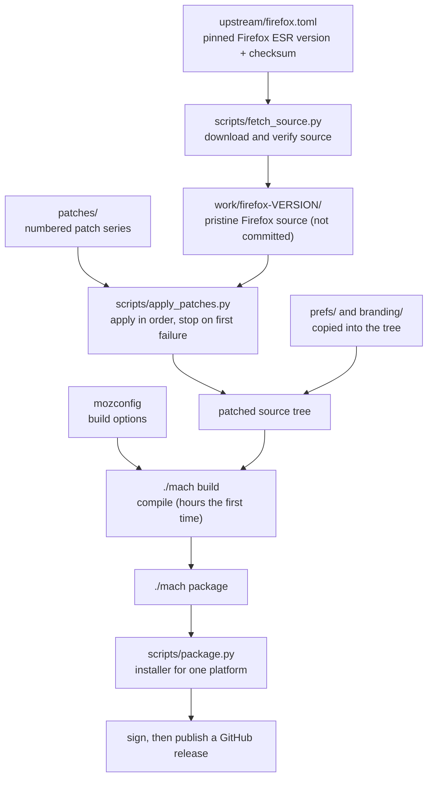
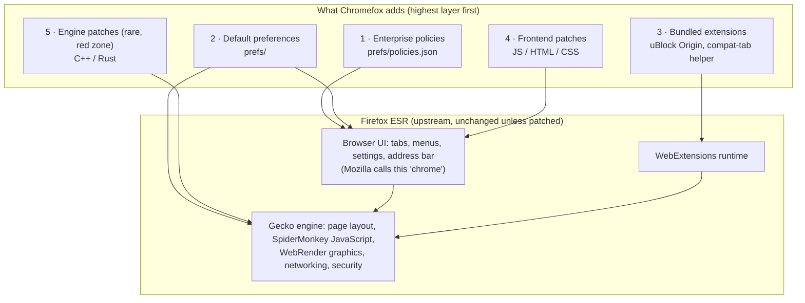
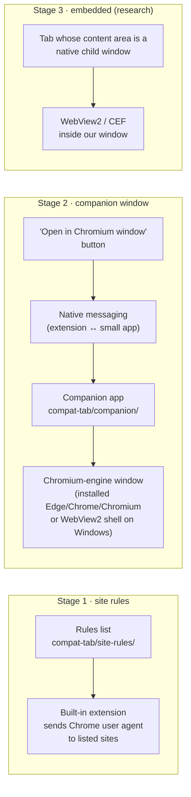
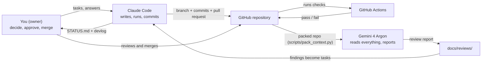

# Architecture

This document explains **what the parts are and how they connect**. It is written for the
owner first. Diagrams use Mermaid, which GitHub renders as pictures.

There are three architectures to understand:

1. **The build pipeline** — how this repository turns into a browser.
2. **The running browser** — the layers inside the browser and which ones we change.
3. **The development system** — how you, Claude Code, Gemini and GitHub work together.

---

## 1. The build pipeline

We never store Firefox's code. We store a recipe: *which* Firefox, *what* to change, *how*
to build. A build follows the recipe from the top.

Key ideas:

- **Pinned version.** One file says exactly which Firefox release we build. Changing it is a
  deliberate, reviewed event (an "upstream update").
- **Patches apply in a fixed order** (by number). If one fails, the build stops and tells us
  which patch and which file — this is how we find conflicts after a Firefox update.
- **Configuration is copied, not coded.** `prefs/policies.json` ends up in the installed
  browser's `distribution/` folder, where Firefox reads it at startup.
- **`mach`** is Mozilla's build tool. `mozconfig` is the file that tells it how to build
  (optimization, branding, which features).
- **Scripts are thin.** Each does one step and can be run alone, so a failure is easy to
  locate. Planned scripts are described in `scripts/README.md`.

---

## 2. The running browser

A browser is layers. Higher layers are easier and safer to change; lower layers are faster
to break and harder to maintain.

### The layers, in plain language

| Layer | What it is | Where it lives in Firefox | How we change it | Survives Firefox updates? |
| --- | --- | --- | --- | --- |
| **Policies** | Rules companies use to manage Firefox (turn things off, install extensions, lock settings) | Read at startup from `distribution/policies.json` | Edit `prefs/policies.json` | Very well — Mozilla supports them officially |
| **Preferences** | Hundreds of on/off and value settings (`about:config`) | Default values are in Firefox's source; can be overridden | Files in `prefs/` | Well, but prefs get renamed or removed |
| **Extensions** | Add-ons using the WebExtensions API | Installed into the profile | Policy installs them; we write our own small ones | Well — stable API |
| **Frontend** | The browser's own interface, written in JavaScript, HTML and CSS | `browser/` and `toolkit/` folders, packed into `omni.ja` | Patches in `patches/` | Moderately — UI code changes often |
| **Engine** | Gecko, the part that turns web pages into pixels | C++ and Rust across most of the source tree | Patches in `patches/`, only with an ADR | Poorly — and mistakes can be security holes |

The rule "least-intrusive layer first" (AGENTS.md rule 2.4) means: try layer 1, then 2, and
so on. Most of this project's goals are met in layers 1–3.

### Processes

Firefox runs as several cooperating programs ("processes"): one **parent** process for the
UI, one **content** process per site or group of sites (so a bad page can't read another
site's data), a **GPU** process for graphics, and a few helpers. Our frontend patches run in
the parent process. Web pages run in content processes. This matters for security reviews
and for performance measurements.

### Where each goal lives

| Goal | Layer(s) | Folder in this repo | Spec |
| --- | --- | --- | --- |
| No AI | Policies (+ maybe frontend patches) | `prefs/`, `patches/0300-no-ai/` | [features/no-ai.md](features/no-ai.md) |
| Debloat | Policies, prefs, frontend patches | `prefs/`, `patches/0200-debloat/` | [features/debloat.md](features/debloat.md) |
| uBlock Origin | Policies (installs the extension) | `prefs/`, `patches/0400-ublock/` (only if needed) | [features/ublock-origin.md](features/ublock-origin.md) |
| Compat tab | Extension + companion app (+ frontend patch for UI) | `compat-tab/`, `patches/0500-compat-tab/` | [features/compat-tab.md](features/compat-tab.md) |
| Performance | Build options, prefs, removal of background work | `mozconfig`, `prefs/`, `patches/0600-performance/`, `perf/` | [features/performance.md](features/performance.md) |
| Branding | Frontend resources + build option | `branding/`, `patches/0100-branding/` | ADR-0005 |

### The compat tab, by stage

Stage 2 deliberately keeps the Chromium engine **in a separate process and window**, so it
cannot crash or slow down the main browser and costs nothing when unused.

---

## 3. The development system

- **Only Claude Code writes.** Gemini reviews. You decide. One author per change keeps the
  history understandable.
- **Memory lives in files**, not chats: `STATUS.md` (where we are), `docs/devlog/` (what
  happened and why), `docs/adr/` (decisions), `docs/features/` (what each feature must do),
  `patches/REGISTRY.md` (every change to Firefox).
- **Checks are automatic.** The same scripts run in Claude Code's hooks and in GitHub
  Actions, so a broken registry or dead doc link is caught in both places.

Details: [WORKFLOW.md](WORKFLOW.md), [QUALITY.md](QUALITY.md), [AI-TEAM.md](AI-TEAM.md).

---

## 4. Repository map

| Path | Purpose | Changed by | Rules |
| --- | --- | --- | --- |
| `AGENTS.md`, `CLAUDE.md`, `GEMINI.md` | Instructions for AI agents | Owner-approved PRs | Keep short; AGENTS.md is the source of truth |
| `docs/STATUS.md` | Current state and next task | Every session | Under 60 lines |
| `docs/adr/` | Architecture decision records | When a hard-to-reverse choice is made | Never edit an accepted ADR's decision; supersede it |
| `docs/features/` | One spec per feature | Before and during feature work | Template in `docs/features/TEMPLATE.md` |
| `docs/learn/` | The owner's curriculum | Occasionally | Plain language |
| `docs/runbooks/` | Step-by-step procedures | When a procedure changes | Must be followable by someone new |
| `docs/devlog/` | Session journal | Every session | One file per session |
| `docs/reviews/` | Gemini and other review reports | After each audit | Findings get triaged into tasks |
| `upstream/` | Pinned Firefox version | Upstream updates only | Use `/upstream-update` |
| `patches/` | Changes to Firefox source | Feature work | Must be in `REGISTRY.md` |
| `prefs/` | Policies and default prefs | Feature work | Every entry commented with why and source |
| `branding/` | Name, icons | Phase 1, Phase 6 | No Mozilla trademarks |
| `compat-tab/` | Compat feature components | Phase 4+ | See its README |
| `perf/` | Benchmark method and results | Performance work | ADR-0006 |
| `scripts/` | Build and check tools | As needed | Each script: one job, `--help`, documented in `scripts/README.md` |
| `tests/` | Smoke and feature tests | With each feature | Every feature has at least a checklist |
| `.claude/` | Claude Code config: hooks, skills, subagents, output style, rules | Rarely | Changes need owner approval |
| `.github/` | CI workflows, PR and issue templates | Rarely | |
