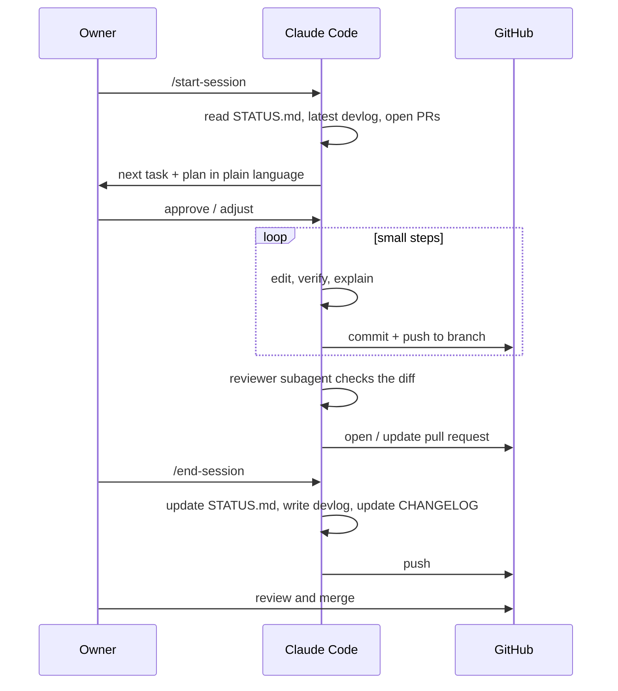

# Workflow: sessions, branches, commits, pull requests

The goal of this workflow is that **any agent or person can pick up the project at any
moment** from the files alone, and that every change on `main` was reviewed, verified and
explained.

## Session lifecycle



**Start of session** (`/start-session` skill):
1. Read `docs/STATUS.md`, the newest `docs/devlog/` entry, and `gh pr list`.
2. If a branch is in progress, check it out and summarize where it stopped.
3. Propose the task (default: first "Next up" item) and a plan. Wait for approval.

**End of session** (`/end-session` skill):
1. Make sure all work is committed on the branch and pushed.
2. Update `docs/STATUS.md`: what changed, new "Next up", blockers, risks.
3. Write `docs/devlog/YYYY-MM-DD-<topic>.md` from the template — for the owner.
4. Open or update the pull request.

**Context switching mid-task** (new chat, new machine, context compacted): the next session
runs `/start-session`, which reconstructs state from `STATUS.md`, the devlog, the branch and
the pull request. Never rely on "what we discussed earlier" unless it is written down.

## Branches

- `main` is always releasable and protected: changes arrive only by pull request with
  passing checks.
- Work branches: `<type>/<topic>`, e.g. `feat/ai-controls-policy`, `fix/registry-check`,
  `docs/learn-lesson-3`, `chore/upstream-153.4.0esr`.
- One task (one roadmap ID) per branch. Delete the branch after merge.
- Releases are git **tags** on `main`: `v153.4.0-cfx.1`.

## Commits ("automatic" but not careless)

Claude Code commits **automatically at every verified checkpoint** — after each small step
that leaves the branch in a working state — and pushes the branch. That gives you a detailed,
recoverable history without anyone remembering to save.

What we deliberately do **not** do is commit on every file save or straight to `main`.
Commit-per-save produces hundreds of meaningless commits, mixes half-finished work into
history, and makes `git bisect` (finding which change broke something) useless.

Commit message format (Conventional Commits):

```text
feat(prefs): block all AI features via AIControls policy

Adds the AIControls policy with Default=blocked and Locked=true so every
current and future Firefox AI feature is off and cannot be re-enabled from
settings. Translations are covered by the same switch (OPEN-QUESTIONS #3).

Spec: docs/features/no-ai.md
Task: P0-03
```

- First line ≤ 72 characters, imperative ("add", not "added").
- Body explains **why**, references the spec/ADR and task ID.
- The PR title uses the same format; CI checks it.

## Pull requests

Every PR uses `.github/PULL_REQUEST_TEMPLATE.md`, which asks for:

- **What and why** in plain language (the owner must be able to follow it).
- **Task ID and spec/ADR links.**
- **How verified** — the exact checks run and what they showed; anything *not* verified.
- **Registry and docs** — confirmation that `patches/REGISTRY.md`, specs and `STATUS.md`
  were updated, or why not.
- **Risk** — which layer was touched; any red-zone areas.

The owner merges with **squash and merge** so each PR becomes one clean commit on `main`
whose message is the PR title and summary. The detailed step commits remain on the PR for
reference.

## One-time GitHub settings (owner does this once, Claude explains each step)

- Branch protection on `main`: require a pull request; require the `Repository consistency` and `Conventional PR title` checks (from the `checks` workflow) to pass;
  block force pushes; block deletion.
- Allow squash merging only; automatically delete head branches after merge.
- Enable private vulnerability reporting (Security tab), for `SECURITY.md`.
- Add repository secrets later (signing keys) — never in files.

## Releases

See [runbooks/release.md](runbooks/release.md). Summary: update `CHANGELOG.md`, tag
`v<firefox-version>-cfx.<n>`, CI builds and attaches installers to a GitHub release.
