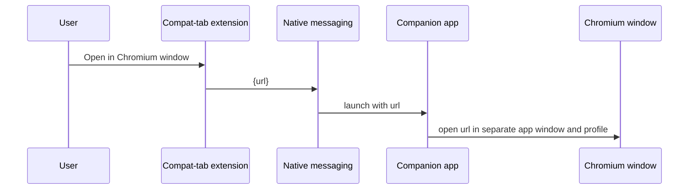

# Feature: Compat tab (Chromium compatibility)

- **Status:** Spec draft
- **Roadmap tasks:** P0-04 (collect sites), P4-01 … P4-05 (stages 1–2), P7-01, P7-02 (stage 3)
- **Pref switches:** `chromefox.compatTab.enabled` (master), `chromefox.compatTab.siteRules.enabled`,
  `chromefox.compatTab.companion.enabled`, `chromefox.compatTab.embedded.enabled` (stage 3, default false)
- **Patch series:** `patches/0500-compat-tab/` (UI hooks only; logic lives in `compat-tab/`)
- **Decision record:** [ADR-0004](../adr/0004-compat-tab-staged.md)
- **Open proposals:** IDEA-01 – IDEA-05 in [OPEN-QUESTIONS.md](../OPEN-QUESTIONS.md) (not yet approved)

> Naming: in Firefox's code "chrome" means the browser UI. This feature is **compat tab**
> everywhere in code, prefs and files. Never name anything here "chrome".

## Problem

Some sites block non-Chrome browsers or rely on Chromium-only behavior. Users currently keep
a second browser for them. We want those sites to work from inside this browser with as
little friction as possible, without weakening the main browser's security or privacy.

## Classify before solving

Every reported site is classified first (in `compat-tab/site-rules/README.md`):

| Class | Symptom | Fix |
| --- | --- | --- |
| A — UA sniffing | "Your browser is not supported", but works when the user agent says Chrome | Stage 1 rule |
| B — Already fixed upstream | Mozilla's built-in web-compatibility interventions (`about:compat`) already handle it | Nothing — confirm and close |
| C — Chromium-only API | Needs WebUSB, WebHID, WebSerial, or another API Firefox doesn't implement | Stage 2 |
| D — Rendering / behavior difference | Layout or script behaves differently in Gecko | Report to the site and to Mozilla's webcompat tracker; stage 2 as a workaround |

## Stage 1 — Site rules

**What:** a list of sites for which we present a Chrome-like user agent (in HTTP headers and
`navigator.userAgent`), plus a UI action "Pretend to be Chrome on this site".

**How:** a small built-in WebExtension in `compat-tab/site-rules/` that modifies requests to
listed hosts and injects the matching `navigator` values. Rules data:

```json
{
  "version": 1,
  "chromeMajor": 0,
  "rules": [
    { "host": "example.com", "includeSubdomains": true, "action": "chrome-ua",
      "reason": "Blocks non-Chrome browsers at login", "issue": "#12", "addedOn": "2026-11-01" }
  ]
}
```

- The Chrome version in the user agent must track **current Chrome stable**; a stale version
  can itself trigger blocks. Updating `chromeMajor` is part of every release checklist.
- The user-agent OS part matches the real OS.
- Rules are reviewed on each release; rules that are no longer needed are removed.

**Done when:** the owner's list from P0-04 is re-tested and every class A site works.

## Stage 2 — Companion window

**What:** a toolbar/context-menu action **"Open in Chromium window"**, and an optional
per-site rule `"action": "open-companion"` that offers it automatically.

**How:**



- Companion app (`compat-tab/companion/`) is a small program registered as a native-messaging
  host. It validates the URL (http/https only), then launches either:
  - an installed Chromium-family browser (Edge, Chrome, Chromium, Brave) in **app mode**
    with a **dedicated profile directory** for compat use; or
  - on Windows, a minimal **WebView2** shell window, so no other browser is required.
- The companion never receives anything except the URL. No cookies or passwords cross over.

**User-facing rules:** pages in the Chromium window have separate cookies and logins, are not
filtered by uBlock Origin, and follow the other engine's privacy settings. The UI says so the
first time the feature is used.

## Stage 3 — Embedded tab (research spike, may never ship)

**What:** a tab in our window whose content area is rendered by WebView2 (Windows first).

**Known hard problems** (each needs a solution before go): positioning a native child window
over the tab's content area and syncing resize, scroll, zoom and DPI; keyboard focus and
shortcuts; context menus, pop-ups, downloads, printing, file pickers, full screen; tab
switching and session restore; accessibility; crash isolation; security boundary between
engines; privacy (separate storage); and the update/security story for the embedded runtime.

**Rules for the spike:** four weeks; behind `chromefox.compatTab.embedded.enabled` (default
false); Windows only; ends with a go/no-go ADR whatever the outcome.

## Performance requirement

The compat tab must cost **nothing measurable** when not in use: no Chromium process running,
no extra memory, no startup delay. Stage 1 rules add only a host lookup per request to listed
sites. Verified per `perf/README.md`.

## Security and privacy

- The companion only accepts `http:` and `https:` URLs and launches only allow-listed
  executables found in standard install locations.
- Native-messaging host manifest restricts callers to our extension's ID.
- No data shared between engines except the URL the user chose to open.
- Stage 3 requires a dedicated security review before any default-on decision.

## Testing

- Stage 1: each class A site in the list loads and logs in; a non-listed site still sends
  the normal user agent.
- Stage 2: open-in-companion works with each supported Chromium browser and with WebView2;
  malformed and non-http URLs are rejected; companion absent → clear error message.

## Results

_Not started. Site list collection begins in P0-04._
